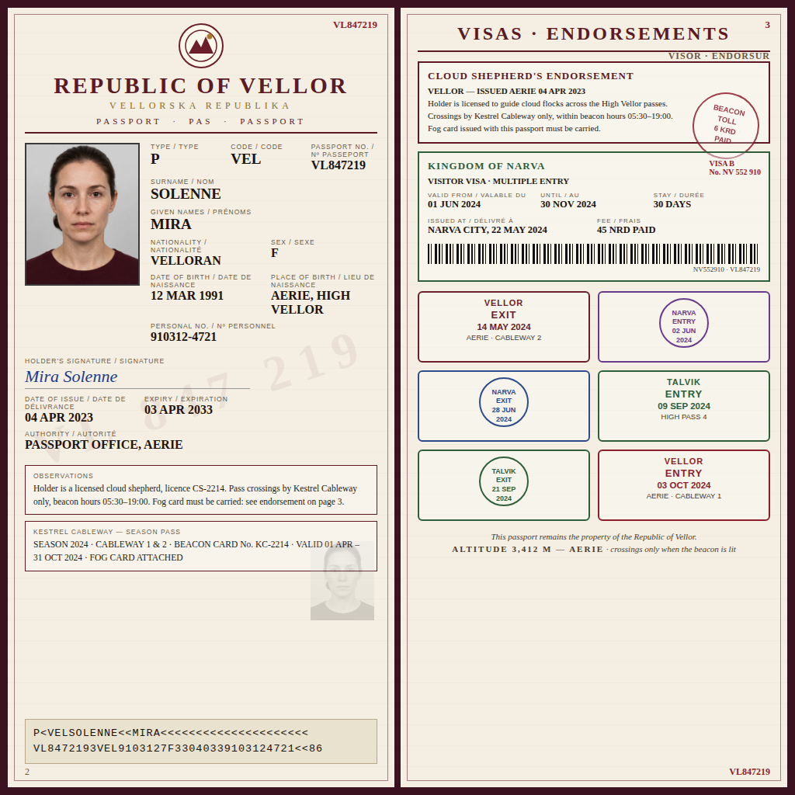

# Republic of Vellor — Passport Page for make.fun

One invented passport spread: the **Republic of Vellor**, a high-altitude
plateau country that does not exist. Holder **Mira Solenne**, licensed cloud
shepherd (licence CS-2214) — pass crossings by Kestrel Cableway only, beacon
hours 05:30–19:00, fog card must be carried. Data page on the left (photo,
fields, signature, observations, season pass, MRZ); visas and endorsements
on the right (cloud shepherd's endorsement, a Narva visitor visa, six
entry/exit stamps from Vellor, Narva and Talvik, altitude strip 3,412 m).

The holder portrait is an AI-generated photorealistic photo of a fictional
person — no real person. The spread is rendered deterministically from
`passport.html` with Playwright; `entry.png` is the rendered output.

